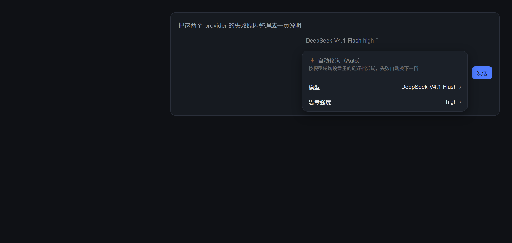
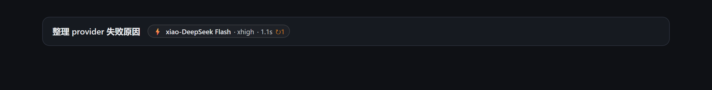
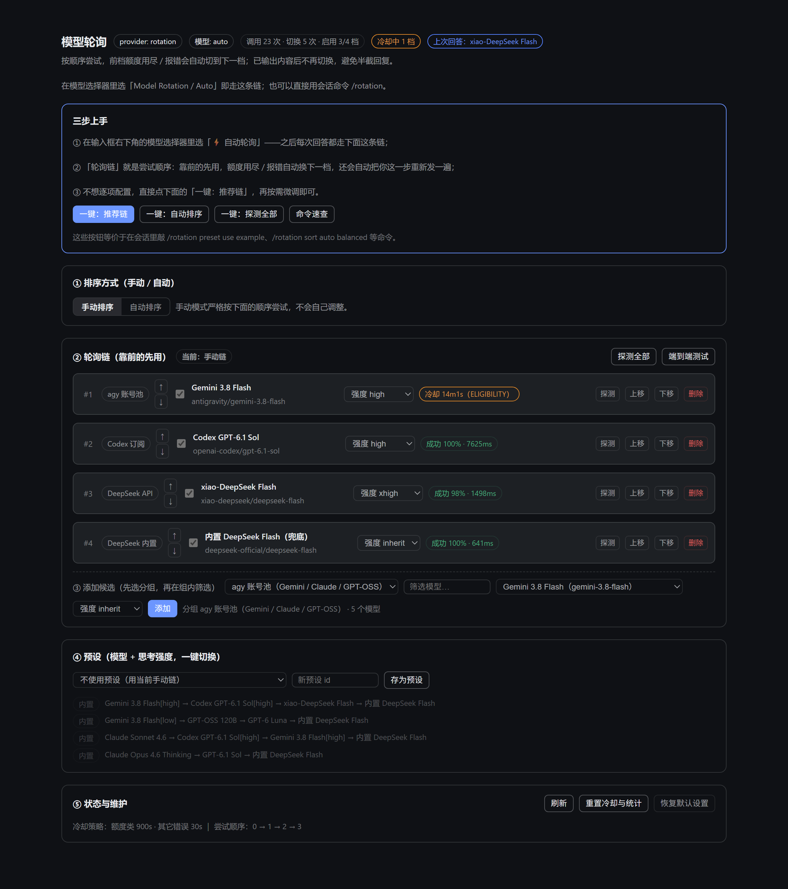

# dsh-model-rotation

[](https://www.npmjs.com/package/dsh-model-rotation)
[](LICENSE)
[](https://github.com/ZhouXuan-Yu/dsh-model-rotation)

> 给 DeepSeek Harness 用的**多来源模型轮询**插件：把 Gemini / Claude / GPT / DeepSeek 排成一条链，
> 前一档**额度用尽或报错**就自动换下一档，并把这一步自动重发；还能随时看到「这次到底是哪个模型答的」。

**TL;DR** — 注册一个虚拟模型 `rotation/auto`。选中它，之后每次提问都按你排好的顺序挑模型：
失败自动降级、必要时整步重发，模型选择器 / 会话头 / 设置页三处都能看到实际用了谁。

| 模型选择器：置顶的「⚡ 自动轮询」 | 会话头：本次回答的模型 |
|---|---|
|  |  |



> 截图由插件真实组件离线渲染（数据为示例）：composer 菜单 / 会话头徽章 / 设置页。

## English (short)

`dsh-model-rotation` is a [DeepSeek Harness](https://github.com/ZhouXuan-Yu/dsh-model-rotation) plugin that turns
your LLM subscriptions into one **ordered, self-healing model chain**.

- **One virtual model** `rotation/auto` — select it once and every turn uses your chain.
- **Grouped by source** — agy account pool (Gemini / Claude / GPT-OSS), Codex subscription, DeepSeek API keys, built-in DeepSeek; filter models per group and pick one.
- **Order it your way** — manual order (`order` / `move` / `up` / `down`) or automatic order by measured success rate & latency.
- **Quota-aware failover** — hard failures (quota, auth, region `ELIGIBILITY`) get a long cooldown; the next attempt simply uses the next model, and the whole step is re-sent automatically (`autoResend`).
- **Presets** — bundle *model + reasoning effort* (e.g. `Gemini 3.8 high`, `Codex GPT-6.1-Sol high`) and switch with one click.
- **See who answered** — composer picker, session-header badge and the settings page all show the model that actually produced the reply.

Install (DSH desktop, local clone): `node scripts/install.mjs` → restart the app → Settings → 模型轮询.

给 DeepSeek Harness 用的**有序多来源模型轮询 + 排序 + 预设**插件。

- 一条可排序的链（默认就是「Gemini 3.8 high → Codex GPT-6.1 Sol high → xiao-DeepSeek Flash → 内置 DeepSeek Flash」），
  前一档**额度用尽 / 鉴权失败 / 报错**时自动切下一档；
- **按来源分组**：agy 账号池 / Codex 订阅 / 两家 DeepSeek API / 内置 DeepSeek 各自成组，
  组内模型可筛选后再加进链（同名模型也不会混，比如 Codex 的 `gpt-6.1-sol` 与 apixiao 的 `gpt-6.1-sol`）；
- **手动排序**：严格按你排的顺序走；
- **自动排序**：按实测成功率 / 延迟动态调整尝试顺序；
- **预设**：把「用哪些模型 + 各自思考强度」存成一组（`example` / `fast` / `coding` / `quality` 内置，也可自存），
  一句话切换，适合按任务类型换档。

## 界面导览（设置 → 模型轮询）

打开 DSH 设置，左侧最下面一项就是 **「模型轮询」**。整页从上到下是：

| 区域 | 内容 |
|---|---|
| **三步上手** | 首次使用的引导卡：一句说明 + 四个一键按钮（推荐链 / 自动排序 / 探测全部 / 命令速查） |
| 顶部状态条 | 排序模式、预设、`冷却中 N 档`、`上次回答：哪个模型`（悬停看耗时与切换） |
| ① 排序方式 | 手动 / 自动；自动再选偏好（均衡 / 更快 / 更稳） |
| ② 轮询链 | 每一档的序号、↑↓、勾选启用、模型、思考强度、成功率与延迟、探测 / 删除 |
| ③ 添加候选 | 先选**分组**，再在组内按关键字**筛选**模型，选强度后加入链尾 |
| ④ 预设 | 下拉应用内置/自存预设；输入名字把当前链存成预设；删除自定义预设 |
| ⑤ 状态与维护 | 刷新、重置冷却与统计、恢复默认（两次确认）、尝试顺序说明、命令输出 |

页面每 5 秒自动刷新状态；所有按钮都等价于一条 `/rotation` 命令，所以命令和界面可以混用。
不确定从哪开始，就点引导卡里的 **「一键：推荐链」**——它会套用内置的 `example` 预设
（Gemini 3.8 Flash[high] → Codex GPT-6.1 Sol[high] → xiao-DeepSeek Flash → 内置 DeepSeek Flash）。

## 模型选择器：置顶的「⚡ 自动轮询」

composer 右下角的模型选择器（`conversation.input.model` 槽位）被本插件接管，菜单**第一行**固定是
**「⚡ 自动轮询（Auto）」**，点它就把当前会话切到 `rotation/auto`，也就是进入本插件的轮询模式 ——
之后每次调用都按设置里的链逐档尝试，前一档失败自动换下一档。

菜单里其余入口保持原样：

- **模型 ›** —— 按来源分组列出所有模型（`agy 账号池` / `Codex 订阅` / `DeepSeek API` /
  `GPT API` / `DeepSeek 内置` / `DeepSeek 账号池`），模型数 > 4 时带搜索框；
- **思考强度 ›** —— 当前模型支持的强度（各来源不一样：Gemini `low/medium/high`、
  Codex `low/medium/high/xhigh/max`、内置 DeepSeek `off/low/high/max`）。

当前是轮询模式时，选择器会显示品牌色的 `⚡ 自动轮询`；选中普通模型则自动退出轮询模式（回到该模型直连）。
所有选择都走官方同一个 per-session `ModelDirectory`（`directory.select`），所以和官方选择器、
`/model` 命令的行为完全一致。

> 说明：官方槽位是 single 槽，插件用更低的 slot priority 遮蔽官方那一份来做整体替换
> （single 槽的同 priority 注册会直接抛错）。若哪天官方改了这块结构导致接管失败，
> 插件只在控制台 warn，不影响 `/rotation` 命令与设置页。

## 对话头上：本次回答到底用了哪个模型

轮询模式下「这次是谁答的」不再靠猜。会话头（标题右侧的 actions 区，`conversation.session.header.actions` 槽位）
会显示一个胶囊徽章，例如：

```
⚡ Codex GPT-6.1 Sol · high · 7.6s · ↻1
```

- **模型名**：实际成功回答的那一档（不是链的第一档）；
- **强度**：本次实际生效的思考强度；
- **耗时**：该档自身的延迟；
- **↻N**：本次回答前有 N 档失败被切换掉了（没有切换则不显示）；
- **悬停**：完整说明，含分组、总耗时、前面每档失败的原因码，以及整段「尝试轨迹」
  （`✅/❌ CODE [分组] provider/model 秒数`）。

徽章显示「本会话最近一次轮询回答」，每 4 秒刷新一次；按会话分别保存（最多 100 个），
不会被另一会话、标题生成或上下文压缩覆盖。强度取真实委托参数，而不是仅取预设值。

**直连的模型也认。** 插件同时监听每一次模型调用（`llm/stream`），所以就算你在选择器里直接选了
`Codex / GPT-6.1 Sol`（没走轮询），徽章也会显示 `◆ deepseek-flash · low · 0.9s · 直连`，
标题是「本会话最近一次回答（直连）：provider/model」。标题生成、上下文压缩这类后台调用不参与，
不会把你的徽章改掉。

### 额度用尽 → 自动「再发一次」

适配器里的切换只对「还没吐出任何内容」的失败安全（已经输出一半再换模型会拼出两截答案）。
所以插件还接管了 agent 循环的失败回调（`agent/request-error`）：

- 轮询模式下的某一步请求失败（额度用尽 / 鉴权失效 / 限流 / 5xx …，中断不算）；
- 失败的那一档已经在适配器里进了冷却，于是**直接让 agent 循环重跑这一步**，
  下一次自然落到链里的下一档模型 —— 效果等同于「自动再发一次你的消息，换成下一个模型回答」；
- 最多重发 `maxAutoResends` 次（默认 2），用完就把错误交还给正常流程；
- 链里所有档都在冷却时不做重发（避免无意义的空转）。

这一层不依赖模型选择器，`rotation/auto` 或 `Model Rotation / Auto` 都一样生效。

### v0.6.1 真机修复

另一个插件的模型选择器 `installDirectorySlots` 使用 priority `-10`，遮住了先前 `-1` 的 Auto 选择器。
本版改为 `-20`，回归测试包含与 `-10` 的竞争检查。会话头仍用独立 list 槽追加，不遮挡其它功能。

## 诊断：接管失败时不再静默

浏览器 console 的错误进不了 host 日志，所以插件自带一条极小的诊断通道：

- client 端在关键节点上报（`apply` / 座位注册成功或失败 / 座位渲染崩溃 / 兜底按钮点击），
  写入 `POST /plugins/model-rotation/client-report`；
- host 端把它写进 `<状态目录>/client-report.jsonl`（保留最近 40 条），
  同时并入 `GET /plugins/model-rotation/state` 的 `clientReports`；
- 座位渲染一旦崩溃，`SeatBoundary` 会兜底成一个「⚡ 自动轮询」按钮（点击仍能切到轮询模式），
  并把错误栈上报 —— 这样即使官方改结构导致接管失败，也不会把你的模型选择器弄没。

排查时：`_probe_rotation_live.mjs` 直接打印运行中的 state / clientReports，或看
`%APPDATA%\dsh-desktop\harness\state\dsh-model-rotation\client-report.jsonl`。

## 图形界面：在设置里配置（推荐）

插件带了 client 上半，会在 **设置 → 模型轮询** 里加一整页可视化面板（`settings.section` 槽位，排在「插件」后面）：

- **排序方式**：手动 / 自动一键切，自动模式还能选偏好（均衡 / 速度优先 / 稳定优先）；
- **轮询链**：每档一行 —— 分组徽章、↑/↓ 上下移、启用勾选、直接下拉换模型、下拉改思考强度、
  删除、单档探测；行内实时显示 `成功 87% · 1200ms` 或 `冷却 12m（QUOTA）`；
- **添加候选**：先选**分组**（agy / Codex / 两家 DeepSeek API / 内置 DeepSeek），
  再用关键字**筛选组内模型**，选模型 → 选思考强度 → 添加；
- **预设**：下拉应用内置/自定义预设，输入 id 把当前链存成新预设，一键删除；
- **状态与维护**：调用/切换次数、当前尝试顺序、探测全部、端到端测试、重置冷却、恢复默认。

面板 5 秒轮询一次 `GET /plugins/model-rotation/state`，所有改动走
`POST /plugins/model-rotation/command`（内部就是 `/rotation` 的子命令），所以 **GUI 和命令行为完全一致**。
改完立刻落盘，不用重启。

## 它是怎么工作的

插件注册一个**虚拟 provider**（默认 id `rotation`），下面只有一个模型 `auto`。
它不接任何 API，只是分发器：

- 会话里选中 `rotation/auto` 后，每次模型调用都进本插件的 `stream()`；
- `stream()` 按当前顺序把请求原样委托给真实 provider（`ctx.llm.stream`）；
- **还没向会话吐出内容**之前失败 → 换下一档；已经输出过内容再失败只能报错（否则会话消息错乱）；
- 用户主动中止（abort）不算失败，不切换、不冷却；
- 所有候选都在冷却时 **fail-open**：仍按顺序试一遍，不会把请求直接打死。

被跳过的候选进冷却表：额度 / 鉴权 / **地区资格（`ELIGIBILITY`）** 类 15 分钟，其它 30 秒。
冷却会跟状态一起落盘，DSH 重启后仍然跳过——不会每次重启都先去白等一次 Gemini 的
「账号/地区不适用」（实测那一档要 10~30 秒才失败）。
**排序方式、当前链、自定义预设、仍然有效的冷却都会落盘**（默认 `<DSH_HOME>/state/dsh-model-rotation/state.json`）。

失败的处理建议会一起显示：`/rotation status` 里冷却行带失败码，`/rotation probe` 失败行
下面多一行 `↳` 说明（例如「该账号/地区不适用，可换 agy 账号或代理，或把这一档停用」）。

## 排序

### 手动排序（默认）

`sortMode: manual`：严格按链顺序尝试，第 1 档不行才用第 2 档。

```
/rotation order 2,1,3     # 按序号重排（只写要前置的几档也行）
/rotation move 3 1        # 把 #3 移到 #1
/rotation up 2            # 上移一档
/rotation down 2          # 下移一档
```

### 自动排序

`sortMode: auto`：给每档记健康度（成功率 EWMA、首字延迟 EWMA、连续失败数），每次调用按偏好重排：

| `autoPrefer` | 打分 | 适合 |
| --- | --- | --- |
| `speed` | `0.2×成功率 + 0.8×速度` | 聊天、轻任务 |
| `balanced`（默认） | `0.5×成功率 + 0.5×速度` | 日常 |
| `reliability` | `0.85×成功率 + 0.15×速度` | 长任务、工具调用 |

```
/rotation sort auto            # 用当前 autoPrefer
/rotation sort auto speed      # 切自动 + 速度优先
/rotation sort manual          # 切回手动
```

自动排序只调「尝试顺序」，不删档；冷却中的档永远排到最后。

### 手动改链

```
/rotation groups                          # 按来源列分组：每组有多少模型、哪些已在链里
/rotation models                          # 同上，外加每个模型支持的思考强度
/rotation set 3 apixiao/gpt-6-sol high    # 把 #3 换成这个模型，思考强度 high
/rotation effort 3 inherit                # 强度沿用会话（inherit）/ none / low / medium / high / xhigh
/rotation add openai-codex/gpt-6-astra high  # 在链尾追加一档（provider 就是分组）
/rotation remove 4                        # 删掉 #4（至少保留一档）
/rotation disable 4                       # 临时停用 #4
/rotation enable 4
```

同一个 provider 可以被多档引用；`group` 字段可覆盖显示分组（用于把多个同源 provider 合并成一组）。

## 预设（模型 + 思考强度打包）

内置四个预设：

| 预设 | 链 |
| --- | --- |
| `example` | Gemini 3.8 Flash `[high]` → Codex GPT-6.1 Sol `[high]` → xiao-DeepSeek Flash → 内置 DeepSeek Flash（= 默认链） |
| `fast` | Gemini 3.8 Flash `[low]` → GPT-OSS 120B → GPT-6 Luna → xiao-DeepSeek Flash → 内置 DeepSeek Flash |
| `coding` | Claude Sonnet 4.6 → Codex GPT-6.1 Sol `[high]` → GPT-6 Sol → DeepSeek V4 Pro `[high]` → 内置 DeepSeek Flash |
| `quality` | Claude Opus 4.6 Thinking → Codex GPT-6.1 Sol `[high]` → GPT-6.1 Sol（API） → DeepSeek V4 Pro `[high]` → 内置 DeepSeek Flash |

```
/rotation preset                # 列出全部预设
/rotation preset use coding     # 切到预设
/rotation preset use chain      # 退出预设，回到手动链
/rotation preset save mine 我的链   # 把当前链（含强度）存成自定义预设
/rotation preset delete mine
```

## 状态与自查

```
/rotation                 # 链 / 排序模式 / 冷却 / 每档成功率与延迟
/rotation groups          # 按来源列分组（每组模型数 + 链里引用了哪些）
/rotation probe           # 逐个直连探测（✅/❌ + 失败码 + 耗时）
/rotation probe 2         # 只探 #2
/rotation probe group openai-codex   # 只探某个分组
/rotation test            # 端到端走一遍虚拟 provider，验证切换逻辑
/rotation reset           # 清冷却 + 健康度统计
/rotation reset-all       # 恢复配置默认（清掉命令改过的链 / 排序 / 自定义预设）
/rotation help
```

agent 侧另有工具 `rotation_probe`：`mode = status | probe | test | models`。

## 配置

改配置有三种入口（等价，改的是同一份运行时状态）：

1. **设置 → 模型轮询**：可视化面板（排序、增删改、强度、预设、状态）。
2. **命令**：`/rotation` 下的 `sort` / `order` / `set` / `effort` / `preset` 等子命令。
3. **设置 → 插件**：`dsh-model-rotation` 的 schema 表单，改的是插件配置（`Config`，静态默认值），适合改 `quotaCooldownMs`、`contextWindow` 这类不常变的键；链与排序请优先用第 1、2 种（它们写状态文件，不会被 schema 默认值覆盖）。

schema 表单里的键：

| 键 | 默认值 | 说明 |
| --- | --- | --- |
| `enabled` | `true` | 总开关 |
| `virtualProviderId` | `rotation` | 虚拟 provider id |
| `virtualModelId` | `auto` | 虚拟模型 id |
| `displayName` | `Model Rotation` | 选择器里显示的名字 |
| `sortMode` | `manual` | `manual` / `auto` |
| `autoPrefer` | `balanced` | 自动排序偏好：`speed` / `balanced` / `reliability` |
| `autoAssumeLatencyMs` | `1500` | 还没测过延迟时的假设值 |
| `chain` | 见下 | 有序链，`{ provider, model, label?, enabled?, reasoningEffort? }` |
| `presets` | 内置 3 组 | 预设数组 `{ id, label, chain }` |
| `activePreset` | 空 | 启用哪个预设（留空=用 chain） |
| `quotaCooldownMs` | `900000` | 额度 / 鉴权类失败冷却 |
| `errorCooldownMs` | `30000` | 其它失败冷却 |
| `passReasoningEffort` | `true` | 是否把会话强度透传给候选 |
| `contextWindow` | `1048576` | 对外声明上下文 |
| `maxTokens` | `0` | 对外声明最大输出（0=不声明） |
| `logSwitches` | `true` | 切换 / 失败打日志 |
| `autoResend` | `true` | 额度用尽等失败后自动用下一档重发这一步（等同「再发一次消息」） |
| `maxAutoResends` | `2` | 同一步最多自动重发几次 |
| `stateFile` | `<DSH_HOME>/state/dsh-model-rotation/state.json` | 排序/链/预设的持久化位置 |

`reasoningEffort` 语义：留空 = 沿用会话（inherit）；`none` = 强制不带强度；其它值 = 覆盖为指定强度。

默认链（= 内置预设 `example`，与本机现有 provider 配置对齐）：

```
antigravity/gemini-3.8-flash      [high]  agy 账号池：Gemini 3.8 Flash
openai-codex/gpt-6.1-sol          [high]  Codex 订阅：GPT-6.1 Sol
xiao-deepseek/deepseek-flash              DeepSeek API：DeepSeek Flash
deepseek-official/deepseek-flash          内置 DeepSeek：DeepSeek Flash（兜底）
```

分组来自 provider id（也是「来源」的天然边界）：

| 分组 | provider id | 说明 |
| --- | --- | --- |
| agy 账号池 | `antigravity` | dsh-agy-link 插件，账号池内部自己再做轮换 |
| Codex 订阅 | `openai-codex` | dsh-codex-subscription 插件（ChatGPT 订阅） |
| DeepSeek API | `xiao-deepseek` | llm-pi-ai 里配的一家 DeepSeek 兼容 API |
| GPT API | `apixiao` | llm-pi-ai 里配的 GPT 兼容 API |
| DeepSeek 内置 | `deepseek-official` | DSH 自带的官方 DeepSeek 账号 |
| DeepSeek 账号池 | `deepseek-account` | llm-deepseek-account 插件的 API Key 账号池（没登录时模型列表为空） |

> 模型清单来自各 provider 的实时目录（`ctx.llm.listModels`），思考强度来自 `resolveModelInfo`，
> 不同来源支持的强度并不相同（例如内置 DeepSeek 是 `off/low/high/max`，Codex 是 `low/medium/high/xhigh/max`），
> 面板里的强度下拉会按真实支持项显示。

## 让它生效

三种方式，任选：

1. **模型选择器第一行**「⚡ 自动轮询（Auto）」（最快，只影响那个会话）；
2. **在模型选择器里选** `Model Rotation / Auto`（同上，分组里的官方名字）；
3. **设为全局默认**：把 profile 里 `agent-default-model` 的 config 改成
   ```yaml
   - id: agent-default-model
     name: "@deepseek-ai/dsh-agent-default-model"
     config:
       provider: rotation
       model: auto
   ```

## 安装

**不能**用 `dsh plugin --profile web add <目录>`：那条命令只是 `pnpm` 的薄包装，
不维护 `dsh.profile.bundles`，装进去不会被加载。用桌面端的「generation」安装通道（仓库自带脚本）：

```powershell
cd C:\Users\ZhouXuan\Documents\deepseek-harness\default-workspace\dsh-model-rotation
$env:ELECTRON_RUN_AS_NODE='1'
& "D:\DSH\DSH Desktop\DSH Desktop.exe" ".\scripts\install.mjs"
```

脚本做的事：从 `app.asar` 加载 `dsh-desktop-market-installer`，用
`installGeneration({sourceDirectory})` 把本目录打成 `profiles/.generations/live/<id>`，
写进 `.generations/desired.json`，再由 `publishInstalledGeneration` 投影成
`profiles/web/node_modules/dsh-model-rotation` 链接 + `dependencies` + `dsh.profile.bundles` 条目。

**装完必须重启 DSH 桌面端**才会加载（Cordis 启动时挂插件，运行中不热加载）。

- **升级**：改完代码重跑 `scripts/install.mjs`（装成新 generation 并切换链接），再重启。
- **卸载**：`& "D:\DSH\DSH Desktop\DSH Desktop.exe" ".\scripts\uninstall.mjs"`，然后重启。
- **验收**：重启后模型选择器第一行出现「⚡ 自动轮询（Auto）」、点它会话切到 `rotation/auto`；
  `/rotation status`；`/rotation groups`（应看到 4~6 个来源分组）；`/rotation probe`（逐档实测，含 Codex 与内置 DeepSeek）；
  `/rotation test`。

## 维护性：不写死容易变的地方

- **分组名不写死**：`agy 账号池` / `Codex 订阅` 这类名字只是**别名**，运行时优先用 provider 自己上报的名字
  （`ctx.llm.listProviders()`），取不到才退回别名、再退回 provider id。以后你换插件、加新的 API provider，
  甚至插件改版把名字改了，分组都会自动跟着显示，不用改代码。
- **排序不写死**：模型分组顺序、模型清单、思考强度集合全部来自目录（`listProviders` / `listModels` /
  `resolveModelInfo`），没有内置任何厂家或型号表参与逻辑；`fast`/`coding`/`quality` 预设只是**模板**，
  随时可以 `preset save` 覆盖或 `reset-all` 丢掉。
- **界面不写死 DOM**：模型选择器是「接官方数据、只替换入口组件」的方式实现的（拿到同一个 per-session
  模型目录），官方改版时如果接不上会自动退回官方选择器，同时上报一条 `client-report`，不会白屏。

## 已知限制

- 冷却不区分「同一 provider 的不同账号」——账号级轮询由 `dsh-agy-link` 自己做
  （它内部有 account pool + sticky 指针），本插件负责「跨 provider 的降级链」。
- Gemini 在账号/地区不适用时会返回 `ELIGIBILITY`：本插件会把它按 15 分钟冷却处理，
  但这一次请求仍要等它 10~30 秒失败后才切到下一档；要么换 agy 账号/代理，要么把这档停用。
- 已经开始输出内容后不能中途换模型，只能报错。
- 不会自动改写 `agent-default-model`，需要手动选或改配置。
- 自动排序的延迟只用首字时间（TTFT）衡量，不含长输出耗时。
